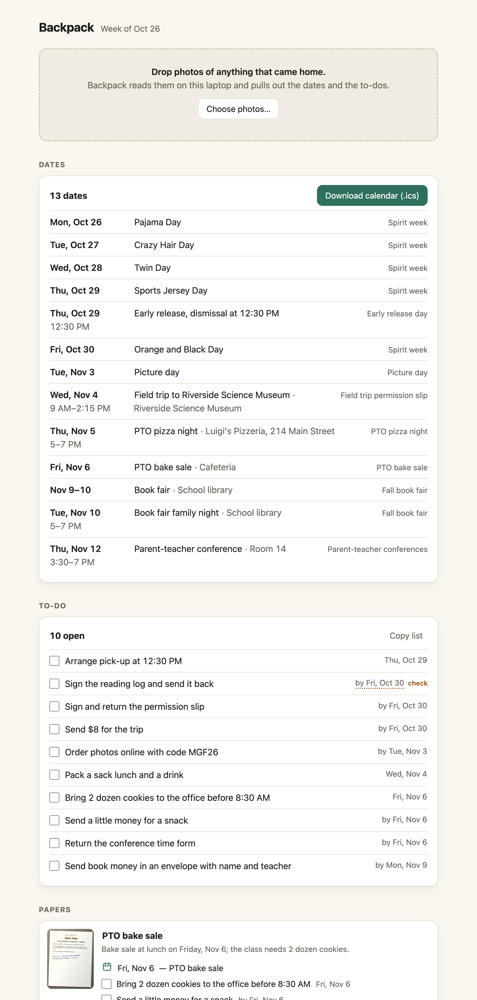

# Backpack

Photograph the pile, get the week.



Every week a school backpack comes home with paper: permission slips, picture
day flyers, "sign and return by Friday", early release, pizza night. Backpack
reads photos of those papers with Gemma 4, an open-weight model that runs on
your own laptop through Ollama, and gives you one page with the dates, the
to-dos and the papers you can throw away. Nothing leaves your computer.

## Install

On a Mac with [Homebrew](https://brew.sh):

```sh
brew install go ollama && brew services start ollama
ollama pull gemma4:e4b
go install github.com/nazboyko/backpack/cmd/backpack@latest
~/go/bin/backpack
```

The last command opens the page in your browser. Next time, run only that one.
The model download is about 7 GB and happens once.

From a clone: `make run`.

## How to use it

1. Take a photo of each paper with your phone and send them to the laptop.
2. Drop the photos on the page. Each one takes a few seconds to read.
3. Read the week: **Download calendar (.ics)** puts every date into your calendar.
4. Tick the to-dos as you do them. Papers that need nothing fold into one line.

A date the model had to work out (a bare "Friday", a blurry number) has a
dotted underline and the word **check**. Click any date, time or title to fix
it; press Enter to keep a guessed date as it is.

## Where your data goes

| What | Where |
|---|---|
| The page | `http://127.0.0.1:7313`, which only this computer can open |
| Your photos | the data folder: `~/Library/Application Support/backpack` on a Mac, `~/.local/share/backpack` on Linux |
| What was read from them | `papers.json` in the same folder |
| The model | Ollama on this computer, `http://127.0.0.1:11434` |
| Anything else | nothing: no account, no analytics, no update check, no crash reports |

Deleting a paper on the page removes its photo. Deleting the data folder removes
everything. The server listens on 127.0.0.1 only, refuses requests addressed to
any other host name, and refuses changes sent by other websites open in your
browser. A test in the repository fails if the code ever names an outside host.

## What it reads well, and what it doesn't

It reads printed notices, flyers, forms and calendars well. On the ten invented
papers in `testdata/papers`, gemma4:e4b found all 13 dates and 8 of the 10
to-dos, about 2 seconds a paper on an Apple M5 Max laptop. It missed "pack a
sack lunch" on a field trip slip and "send a little money" on a bake sale
flyer.

It does worse with handwriting, faint photocopies, papers shot at a steep angle
and letters longer than one page (one photo is one page). That is why every
guessed date is marked for you to check before you trust it.

Photos can be JPEG, PNG or HEIC. HEIC needs a Mac (Backpack converts it with
the `sips` tool that comes with macOS); elsewhere, save the photo as JPEG first.

## Change the model

```sh
BACKPACK_MODEL=gemma4:26b ~/go/bin/backpack
```

On the same ten papers, gemma4:26b found all 13 dates and all 10 to-dos, at
about 3.6 seconds a paper and an 18 GB download. `BACKPACK_OLLAMA` points
Backpack at Ollama on another address. Flags: `--port`, `--data` (another data
folder), `--no-open`, `--version`.

## For developers

One Go binary with the page embedded (plain HTML, CSS and JavaScript, no build
step). `make check` runs gofmt, go vet, the unit tests and an end-to-end test
against a fake Ollama with the race detector. `make live-check` reads the ten
fixture papers with the real model and prints the score. `make screenshots`
renders the images in `docs/img`. `make fixtures` redraws the invented papers
from `testdata/papers/html`.

## Credits

[Gemma 4](https://ai.google.dev/gemma) (open weights, Google) does the reading,
served by [Ollama](https://ollama.com). Image scaling uses
[golang.org/x/image](https://pkg.go.dev/golang.org/x/image) (BSD license).
Everything else is the Go standard library.

## Contest

Built for the DEV Hacktoberfest Open-Source AI Challenge, Week 3 "Slow and
Steady", October 2026. The post: [HUMAN: link to the published DEV post].

## License

MIT, see [LICENSE](LICENSE).

## Changes after the deadline

None.
